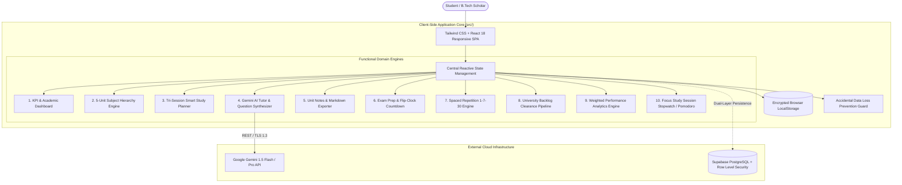

# 🎓 STUDYHUB AI — Personal Smart Academic Management System
### *An Autonomous, AI-Orchestrated Engineering Productivity & Curriculum Mastery Platform*

<div align="center">

[](https://react.dev/)
[](https://www.typescriptlang.org/)
[](https://vitejs.dev/)
[](https://tailwindcss.com/)
[](https://ai.google.dev/)
[](https://supabase.com/)
[](LICENSE)

<br/>

**[Live Demo](http://localhost:5173/)** • **[System Architecture](#-system-architecture)** • **[Core Modules](#-comprehensive-module-breakdown)** • **[Database Schema](#-database-architecture--schema)** • **[Getting Started](#-installation--getting-started)** • **[Security](#-enterprise-security--data-loss-prevention)**

</div>

---

## 📌 Executive Summary

**STUDYHUB AI** is an enterprise-grade, privacy-first personal academic management system and AI study companion engineered specifically for undergraduate engineering (B.Tech) students. 

Traditional productivity suites (e.g., Notion, Todoist, Google Calendar) fail to capture the rigorous hierarchical constraints of undergraduate engineering curricula: **subjects divided strictly into 5 modular syllabus units**, **7-mark long-answer examinations**, **previous question paper (PYQ) patterns**, and **spaced cognitive revision timelines**. 

STUDYHUB AI bridges this gap by unifying curriculum tracking, tri-session timetable planning, Ebbinghaus spaced repetition schedules, university backlog clearance pipelines, and generative AI tutoring powered by **Google Gemini** into a single, cohesive, modern workspace.

---

## 🏗️ System Architecture



---

## ⚡ Technical Specifications

| Layer | Technologies / Frameworks | Purpose |
| :--- | :--- | :--- |
| **Frontend Framework** | **React 18.3.1**, **Vite 6.1.0** | High-performance SPA with fast HMR and sub-millisecond route transitions |
| **Type Safety** | **TypeScript 5.7.2** | Strict interfaces covering subjects, units, revisions, tasks, and exam data |
| **Design System** | **Tailwind CSS 3.4.17**, **Lucide Icons** | Premium dark/light themes, accessible contrast ratios, responsive mobile drawer |
| **AI Orchestration** | **Google Gemini 1.5 Flash API** | Generates 7-mark answers, MCQs, step-by-step proofs, and revision summaries |
| **State & Persistence** | **Dual-Layer Reactive Architecture** | Offline-first reactive local store with automated background cloud synchronization |
| **Database & Auth** | **Supabase (PostgreSQL 15)** | Row Level Security (RLS), relational integrity, cascading foreign keys |
| **Data Protection** | **Accidental Loss Guard** | Continuous shadow backups, confirmation modals, single-click JSON snapshot exports |

---

## 🎯 Comprehensive Module Breakdown

### 1. Executive Academic Dashboard
- **KPI Grid**: Real-time counters for Total Subjects, Total Units (40 units total), Completed Units, and Pending Units.
- **Mastery Meter**: Overall percentage progress bar across all 8 semesters/subjects.
- **Study Velocity**: Daily logged focus hours vs. user-defined 4.0-hour targets.
- **Urgent Examination Alert**: Dynamic banner computing precise days left for the closest university exam.
- **Today's Action Plan**: Auto-filtered checklist categorized by Morning, Afternoon, and Night study slots.

---

### 2. Subject & 5-Unit Curriculum Management
Every B.Tech engineering course is strictly compartmentalized into **5 units**. STUDYHUB AI comes pre-seeded with 8 core engineering disciplines:

| Subject Code | Subject Name | Default Priority | Key Focus Areas |
| :--- | :--- | :---: | :--- |
| **CS601PC** | **Big Data Analytics (BDA)** | High | HDFS, MapReduce, HBase/NoSQL, Spark RDDs, GraphX |
| **HS602PE** | **Human Resource & Project Management (HRPM)** | Medium | Job Analysis, 360° Appraisal, WBS, CPM/PERT Analysis |
| **CS603PC** | **Software Architecture & Design Patterns (SADP)** | High | Quality Attributes, Architectural Styles, GoF Patterns |
| **MA604BS** | **Discrete Mathematics & Graph Theory (DMGT)** | High | Predicates, Posets/Lattices, Groups, Recurrence, Graphs |
| **CS605PE** | **Internet of Things (IoT)** | Medium | IoT Levels, MQTT/CoAP Protocols, Microcontrollers, Security |
| **EC606ES** | **Digital Electronics (DE)** | Medium | K-Maps, Adders/Mux, Flip-Flops, MOD Counters, PLDs/FPGAs |
| **EC607PC** | **Embedded Systems (ES)** | Medium | ARM Cortex, I2C/SPI/CAN Buses, RTOS Priority Ceiling, JTAG |
| **CS608PC** | **Advanced Data Structures (ADS)** | High | AVL/Red-Black Trees, B/B+ Trees, Fibonacci Heaps, Tries |

- **Full CRUD Capabilities**: Add custom electives, modify subject codes, change color palettes, and set target exam dates.
- **Topic Checklist**: Micro-tracking at the individual topic level with special **Important (`⭐`)** indicators.

---

### 3. Tri-Session Smart Study Planner
Engineering schedules demand distinct focus phases throughout the day. STUDYHUB AI organizes work into 3 dedicated operational slots:
- 🌅 **Morning Session (06:00 – 12:00)**: Complex mathematical proofs, algorithms, and deep work.
- ☀️ **Afternoon Session (12:00 – 18:00)**: Lab programs, system design, and practical exercises.
- 🌙 **Night Session (18:00 – 00:00)**: Rapid theoretical revisions, flashcards, and summary notes.
- **Automated Rollover**: Unfinished tasks from prior days are automatically flagged with an alert and can be rescheduled to today with one click.

---

### 4. Gemini AI Study Tutor & University Exam Engine
The AI Tutor integrates **Google Gemini 1.5 Flash** with custom academic prompt templates engineered for university engineering evaluations:
- **📝 7-Mark University Exam Answers**: Structured in standard university format:
  1. *Formal 2-Line Definition*
  2. *ASCII / Mermaid Block Architecture Diagram*
  3. *Step-by-Step Technical Working Mechanism*
  4. *Comparative Advantages and Limitations Table*
  5. *Real-World Engineering Application & Case Study*
  6. *Concluding Summary*
- **💡 Simple English (ELI5)**: Explains dense topics using intuitive real-world analogies.
- **📌 High-Yield Bullet Notes**: Compact summaries of key definitions, formulas, and common exam traps.
- **🎯 Interactive Practice MCQs**: Generates self-grading 4-option quizzes with immediate scoring and confetti celebration animations.
- **⭐ Important Questions**: Predicts top 2-mark definitions and 7-mark analytical questions per unit.
- **Anti-Hallucination Ground Truth**: Allows students to paste their university syllabus excerpts or textbook text into a reference box to ground AI outputs strictly in verified academic material.

---

### 5. Curriculum Notes & Document Manager
- **Hierarchical Taxonomy**: Organized strictly by **Subject ➔ Unit (1 to 5)**.
- **In-App Markdown Editor**: Full syntax support for code blocks, mathematical expressions, lists, and tables.
- **One-Click Export**: Export notes to native **`.md` files** for local archiving or printing.
- **Fast Search**: Full-text client search across note titles, contents, and tags.

---

### 6. Examination Command Center
- **Live Flip Countdown Timers**: Millisecond-accurate countdowns measuring **Days : Hours : Minutes : Seconds** to each scheduled examination.
- **5-Unit Readiness Index**: Calculates percentage of syllabus completely covered and revised for each subject.
- **PYQ Repository**: Built-in repository tracker for Previous Years University Question Papers (Regular and Supplementary).

---

### 7. Spaced Repetition Engine (1-7-30 Day Protocol)
Based on Hermann Ebbinghaus's exponential forgetting curve, memory retention rapidly decays without structured intervals:

$$R = e^{-\frac{t}{S}}$$

STUDYHUB AI automates review scheduling at proven biological retention checkpoints:
- **Review 1 (+1 Day)**: Consolidates working memory into short-term storage.
- **Review 2 (+7 Days)**: Strengthens neural pathway retrieval.
- **Review 3 (+30 Days)**: Permanently encodes concepts into long-term memory for semester finals.
- Tracks review completion states (*Due Today*, *Upcoming*, *Completed*) with visual badges.

---

### 8. University Backlog Clearance Pipeline
A specialized tracker dedicated to clearing supplementary examinations without falling behind:
- Fields for **Subject Name, Subject Code, Semester, Attempt Number, Target Exam Date, and Result Status** (*Pending*, *Cleared*, *Failed*).
- **3-Point Clearance Verification Checklist**:
  1. *All 5 Units Covered & Notes Written*
  2. *Last 5 Years University PYQs Solved*
  3. *1-7-30 Day Spaced Revisions Completed*

---

### 9. Productivity & Readiness Analytics
- **Mastery Distribution**: Color-coded progress bars comparing completion across all 8 subjects.
- **Time Distribution**: Daily and weekly study duration tracking (hours logged vs. goal).
- **Revision Adherence**: Real-time percentage tracking of spaced repetition completion.
- **Weighted Readiness Index**: Composite metric combining syllabus completion (60%), spaced revision rate (20%), and study hours logged (20%).

---

### 10. Focus Study Session Stopwatch & Pomodoro
- Integrated digital stopwatch modal with **Start**, **Pause**, and **Reset** controls.
- Allows students to log completed study blocks directly under specific subjects, units, and time slots into the analytics database.

---

## 🗄️ Database Architecture & Schema

For users opting into cloud synchronization via **Supabase PostgreSQL**, STUDYHUB AI provides a normalized relational schema with full **Row Level Security (RLS)**:

```sql
-- 1. Profiles (Student Identity & Goals)
CREATE TABLE public.profiles (
    id UUID PRIMARY KEY REFERENCES auth.users(id) ON DELETE CASCADE,
    email TEXT UNIQUE NOT NULL,
    full_name TEXT,
    college_name TEXT DEFAULT 'B.Tech Engineering College',
    branch TEXT DEFAULT 'Computer Science & Engineering',
    semester INT DEFAULT 6,
    daily_study_goal_hours NUMERIC(4,2) DEFAULT 4.0,
    created_at TIMESTAMP WITH TIME ZONE DEFAULT timezone('utc'::text, now()) NOT NULL
);

-- 2. Subjects (Curriculum Master)
CREATE TABLE public.subjects (
    id UUID PRIMARY KEY DEFAULT uuid_generate_v4(),
    user_id UUID REFERENCES public.profiles(id) ON DELETE CASCADE,
    code TEXT NOT NULL,
    name TEXT NOT NULL,
    priority TEXT CHECK (priority IN ('High', 'Medium', 'Low')) DEFAULT 'Medium',
    exam_date DATE,
    color TEXT DEFAULT '#4f46e5',
    created_at TIMESTAMP WITH TIME ZONE DEFAULT timezone('utc'::text, now()) NOT NULL
);

-- 3. Units (Strict 5-Unit Structure)
CREATE TABLE public.units (
    id UUID PRIMARY KEY DEFAULT uuid_generate_v4(),
    subject_id UUID REFERENCES public.subjects(id) ON DELETE CASCADE NOT NULL,
    unit_number INT CHECK (unit_number BETWEEN 1 AND 5) NOT NULL,
    title TEXT NOT NULL,
    completed BOOLEAN DEFAULT false,
    weightage_marks INT DEFAULT 14,
    created_at TIMESTAMP WITH TIME ZONE DEFAULT timezone('utc'::text, now()) NOT NULL
);

-- 4. Topics (Micro-Syllabus Items)
CREATE TABLE public.topics (
    id UUID PRIMARY KEY DEFAULT uuid_generate_v4(),
    unit_id UUID REFERENCES public.units(id) ON DELETE CASCADE NOT NULL,
    title TEXT NOT NULL,
    is_important BOOLEAN DEFAULT false,
    completed BOOLEAN DEFAULT false,
    created_at TIMESTAMP WITH TIME ZONE DEFAULT timezone('utc'::text, now()) NOT NULL
);

-- 5. Study Sessions (Pomodoro & Stopwatch Logs)
CREATE TABLE public.study_sessions (
    id UUID PRIMARY KEY DEFAULT uuid_generate_v4(),
    user_id UUID REFERENCES public.profiles(id) ON DELETE CASCADE NOT NULL,
    subject_id UUID REFERENCES public.subjects(id) ON DELETE SET NULL,
    unit_id UUID REFERENCES public.units(id) ON DELETE SET NULL,
    duration_minutes INT NOT NULL,
    session_slot TEXT CHECK (session_slot IN ('Morning', 'Afternoon', 'Night')) DEFAULT 'Morning',
    notes_summary TEXT,
    created_at TIMESTAMP WITH TIME ZONE DEFAULT timezone('utc'::text, now()) NOT NULL
);

-- 6. Daily Tasks (Planner Items)
CREATE TABLE public.daily_tasks (
    id UUID PRIMARY KEY DEFAULT uuid_generate_v4(),
    user_id UUID REFERENCES public.profiles(id) ON DELETE CASCADE NOT NULL,
    subject_id UUID REFERENCES public.subjects(id) ON DELETE SET NULL,
    title TEXT NOT NULL,
    scheduled_date DATE DEFAULT CURRENT_DATE NOT NULL,
    session_slot TEXT CHECK (session_slot IN ('Morning', 'Afternoon', 'Night')) DEFAULT 'Morning',
    completed BOOLEAN DEFAULT false,
    rescheduled_count INT DEFAULT 0,
    created_at TIMESTAMP WITH TIME ZONE DEFAULT timezone('utc'::text, now()) NOT NULL
);

-- 7. Notes (Markdown Repository)
CREATE TABLE public.notes (
    id UUID PRIMARY KEY DEFAULT uuid_generate_v4(),
    user_id UUID REFERENCES public.profiles(id) ON DELETE CASCADE NOT NULL,
    subject_id UUID REFERENCES public.subjects(id) ON DELETE CASCADE NOT NULL,
    unit_id UUID REFERENCES public.units(id) ON DELETE CASCADE NOT NULL,
    title TEXT NOT NULL,
    content TEXT NOT NULL,
    created_at TIMESTAMP WITH TIME ZONE DEFAULT timezone('utc'::text, now()) NOT NULL,
    updated_at TIMESTAMP WITH TIME ZONE DEFAULT timezone('utc'::text, now()) NOT NULL
);

-- 8. Exams (Timetable & Rooms)
CREATE TABLE public.exams (
    id UUID PRIMARY KEY DEFAULT uuid_generate_v4(),
    user_id UUID REFERENCES public.profiles(id) ON DELETE CASCADE NOT NULL,
    subject_id UUID REFERENCES public.subjects(id) ON DELETE CASCADE NOT NULL,
    exam_date TIMESTAMP WITH TIME ZONE NOT NULL,
    exam_type TEXT CHECK (exam_type IN ('Mid-1', 'Mid-2', 'Semester Final', 'Lab External')) DEFAULT 'Semester Final',
    room_number TEXT,
    target_score INT DEFAULT 85,
    created_at TIMESTAMP WITH TIME ZONE DEFAULT timezone('utc'::text, now()) NOT NULL
);

-- 9. Spaced Revisions (1-7-30 Protocol)
CREATE TABLE public.revisions (
    id UUID PRIMARY KEY DEFAULT uuid_generate_v4(),
    user_id UUID REFERENCES public.profiles(id) ON DELETE CASCADE NOT NULL,
    subject_id UUID REFERENCES public.subjects(id) ON DELETE CASCADE NOT NULL,
    unit_id UUID REFERENCES public.units(id) ON DELETE CASCADE NOT NULL,
    topic_title TEXT NOT NULL,
    initial_study_date DATE DEFAULT CURRENT_DATE NOT NULL,
    rev_1_date DATE NOT NULL,
    rev_1_done BOOLEAN DEFAULT false,
    rev_2_date DATE NOT NULL,
    rev_2_done BOOLEAN DEFAULT false,
    rev_3_date DATE NOT NULL,
    rev_3_done BOOLEAN DEFAULT false,
    created_at TIMESTAMP WITH TIME ZONE DEFAULT timezone('utc'::text, now()) NOT NULL
);

-- 10. Backlogs (Supplementary Paper Pipeline)
CREATE TABLE public.backlogs (
    id UUID PRIMARY KEY DEFAULT uuid_generate_v4(),
    user_id UUID REFERENCES public.profiles(id) ON DELETE CASCADE NOT NULL,
    subject_name TEXT NOT NULL,
    subject_code TEXT NOT NULL,
    semester INT NOT NULL,
    attempt_number INT DEFAULT 1,
    preparation_status TEXT CHECK (preparation_status IN ('Not Started', 'In Progress', 'Ready', 'Exam Taken')) DEFAULT 'In Progress',
    exam_date DATE,
    result_status TEXT CHECK (result_status IN ('Pending', 'Cleared', 'Failed')) DEFAULT 'Pending',
    checklist_syllabus_covered BOOLEAN DEFAULT false,
    checklist_pyq_solved BOOLEAN DEFAULT false,
    checklist_revision_done BOOLEAN DEFAULT false,
    created_at TIMESTAMP WITH TIME ZONE DEFAULT timezone('utc'::text, now()) NOT NULL
);

-- 11. Quiz Results (Practice Tests)
CREATE TABLE public.quiz_results (
    id UUID PRIMARY KEY DEFAULT uuid_generate_v4(),
    user_id UUID REFERENCES public.profiles(id) ON DELETE CASCADE NOT NULL,
    subject_id UUID REFERENCES public.subjects(id) ON DELETE CASCADE NOT NULL,
    unit_id UUID REFERENCES public.units(id) ON DELETE CASCADE NOT NULL,
    score INT NOT NULL,
    total_questions INT NOT NULL,
    created_at TIMESTAMP WITH TIME ZONE DEFAULT timezone('utc'::text, now()) NOT NULL
);

-- Row Level Security (RLS) Enforcement
ALTER TABLE public.profiles ENABLE ROW LEVEL SECURITY;
ALTER TABLE public.subjects ENABLE ROW LEVEL SECURITY;
ALTER TABLE public.units ENABLE ROW LEVEL SECURITY;
ALTER TABLE public.topics ENABLE ROW LEVEL SECURITY;
ALTER TABLE public.study_sessions ENABLE ROW LEVEL SECURITY;
ALTER TABLE public.daily_tasks ENABLE ROW LEVEL SECURITY;
ALTER TABLE public.notes ENABLE ROW LEVEL SECURITY;
ALTER TABLE public.exams ENABLE ROW LEVEL SECURITY;
ALTER TABLE public.revisions ENABLE ROW LEVEL SECURITY;
ALTER TABLE public.backlogs ENABLE ROW LEVEL SECURITY;
ALTER TABLE public.quiz_results ENABLE ROW LEVEL SECURITY;

CREATE POLICY "Users can manage own profiles" ON public.profiles FOR ALL USING (auth.uid() = id);
CREATE POLICY "Users can manage own subjects" ON public.subjects FOR ALL USING (auth.uid() = user_id);
CREATE POLICY "Users can manage own notes" ON public.notes FOR ALL USING (auth.uid() = user_id);
CREATE POLICY "Users can manage own tasks" ON public.daily_tasks FOR ALL USING (auth.uid() = user_id);
CREATE POLICY "Users can manage own sessions" ON public.study_sessions FOR ALL USING (auth.uid() = user_id);
CREATE POLICY "Users can manage own revisions" ON public.revisions FOR ALL USING (auth.uid() = user_id);
CREATE POLICY "Users can manage own backlogs" ON public.backlogs FOR ALL USING (auth.uid() = user_id);
```

---

## 💻 Installation & Getting Started

### Prerequisites
- **Node.js**: v18.0.0 or higher
- **npm**: v9.0.0 or higher (or pnpm / yarn)

### 1. Clone the Repository
```bash
git clone https://github.com/sumanth-bandla/study.git
cd study
```

### 2. Install Dependencies
```bash
npm install
```

### 3. Environment Variables (Optional)
Create a `.env` file in the root directory:
```env
# Optional: Pre-fill Gemini API Key (or enter it in the app UI)
VITE_GEMINI_API_KEY=your_gemini_api_key_here

# Optional: Supabase credentials for cloud sync
VITE_SUPABASE_URL=https://your-project.supabase.co
VITE_SUPABASE_ANON_KEY=your-supabase-anon-key
```

### 4. Run Development Server
```bash
npm run dev
```
Open **[http://localhost:5173](http://localhost:5173)** in your browser.

### 5. Compile for Production
```bash
npm run build
npm run preview
```

---

## 🔒 Enterprise Security & Data Loss Prevention

1. **Client-Side Safeguards**:
   - Destructive actions (deleting a subject, erasing notes, or clearing backlog records) require explicit user confirmation.
   - Every state change triggers a background shadow snapshot stored in local storage (`STUDYHUB_AUTO_BACKUP_LATEST`).
2. **Single-Click JSON Backup & Restore**:
   - Students can export their entire academic state (all subjects, units, notes, tasks, exams, revisions, backlogs) to an offline JSON snapshot at any time via the sidebar button.
3. **API Key Isolation**:
   - Gemini API keys are never hardcoded or exposed in frontend bundle assets. Keys are stored in the client's local session memory or loaded from environment variables.
4. **Zero-Knowledge Architecture**:
   - All study materials, notes, and academic performance data remain private on the user's client device unless cloud sync is explicitly enabled.

---

## 📂 Project Directory Structure

```text
studyhub-ai/
├── index.html                   # HTML entry point with Inter font integration
├── package.json                 # Dependency manifest and npm scripts
├── postcss.config.js            # PostCSS configuration for Tailwind
├── tailwind.config.js           # Tailwind theme design system configuration
├── tsconfig.json                # TypeScript compiler configuration
├── vite.config.ts               # Vite bundler configuration with dev server
├── src/
│   ├── main.tsx                 # React DOM root render
│   ├── App.tsx                  # Master application orchestrator & navigation
│   ├── index.css                # Base Tailwind styles & custom scrollbars
│   ├── types.ts                 # Full TypeScript domain model interfaces
│   ├── data/
│   │   └── initialData.ts       # Pre-seeded BDA, HRPM, SADP, DMGT, IoT, DE, ES, ADS data
│   ├── lib/
│   │   ├── accidentalLossGuard.ts # Automated shadow backup & JSON export/import
│   │   └── supabase.ts          # Supabase client initializer
│   ├── services/
│   │   └── geminiService.ts     # Gemini AI prompt orchestration engine
│   ├── context/
│   │   └── AppContext.tsx       # Central state management & local persistence
│   └── components/
│       ├── DashboardView.tsx    # KPI metrics, upcoming exams, today's schedule
│       ├── SubjectsView.tsx     # 5-unit curriculum manager & topic checklists
│       ├── PlannerView.tsx      # Tri-session planner & overdue task rollover
│       ├── AITutorView.tsx      # Gemini 7-mark answers & interactive MCQ quizzes
│       ├── NotesView.tsx        # Unit notes, Markdown editor & export
│       ├── ExamPrepView.tsx     # Exam countdown timers & PYQ bank
│       ├── RevisionView.tsx     # Spaced repetition engine (1-7-30 days)
│       ├── BacklogView.tsx      # University supplementary paper tracker
│       ├── AnalyticsView.tsx    # Visual mastery charts & readiness index
│       └── StudyTimerModal.tsx  # Focus study timer & stopwatch session logger
└── README.md                    # System documentation
```

---

## 🤝 Contributing

Contributions, bug reports, and feature requests are welcome!

1. Fork the Project: `git checkout -b feature/AmazingFeature`
2. Commit your Changes: `git commit -m 'Add some AmazingFeature'`
3. Push to the Branch: `git push origin feature/AmazingFeature`
4. Open a Pull Request.

---

## 📄 License

Distributed under the **MIT License**. See `LICENSE` for more information.

---

<div align="center">
  <b>Built for Engineering Scholars • Study Smart with STUDYHUB AI</b>
</div>
